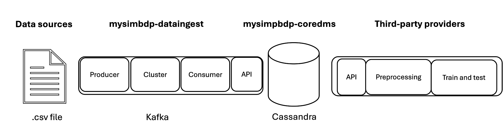

# Report for Assignment 1 

## Design

### Application domain and dataset 
Machine learning, and especially deep learning models, have proven to be helpful in many domains, such as cybersecurity. As an example, network security can be improved with the use of intrusion detection systems. These can be developed using DL models trained with expected and malicious traffic. The UNSW-NB15 dataset provides exactly this type of data. 

More specifically, the UNSW-NB15 dataset includes 49 different features extracted from raw network packages. Some of these features are categorical, such as the protocol used, some are binary, such as is_ftp_login (ftp login access with password or not), and the rest are numerical features. As for the labels, we have if a certain sample is expected or malicious traffic in binary form and also categorical, as each sample is classified based on the type of attack that they were being a part from (or if they were normal traffic). For more information about the data types, check Reference 1. At first, the data extracted has the form of `.pcap` files. Then, the `.csv` files are obtained with a combination of algorithms and tools partially disclosed by the authors of the dataset.

The idea is to develop a platform that ingests and stores data that can be later used for training models that classify the nature of network traffic. As the training of DL models is improved by large amounts of data, the platform should be prepared to handle the storing of thousands of entries, and this size could only increase even more. 

To obtain the dataset: https://research.unsw.edu.au/projects/unsw-nb15-dataset 

### **mysimbdp** architecture
The architecture used for this platform is the following: 

 
It contemplates the use of Apache Kafka for the **mysimbdp-dataingest**, using a Kafka producer and consumer to ingest and extract the data. The original UNSW-NB15 dataset provides all data separated into 4 main `.csv` files. In the development, one of the partitions is used to experience the operations in the data pipeline, which is the file `UNSW-NB15_4.csv`. Then, an API is used to save the data to Apache Cassandra, which works as **mysimbdp-coredms**. 

The reason why Cassandra is used is because it has very good properties for supporting ML platforms. Firstly,  if the dataset increases its size significantly, Cassandra supports horizontal scaling. Then, the maintenance cost and overhead is low. Also, processing data (read or write) works fast. There are many ML platform projects that use Cassandra nowadays, which reinforces this decision. 

Once the data is stored, the rest of the architecture is contemplated to be an implementation of third-party providers. This includes an optional API to get the data, which can be pictured as a way to get randomized sets of data for training and testing purposes (not necessarily one for training and one for testing as Federated Learning demands the training of models in distributed nodes without sharing datasets). Then, preprocessing is performed and finally models are developed. 

### **mysimbdp-coredms** configuration 

To prevent a single-point-of-failure problem, the cluster formed within **mysimbdp-coredms** can contain more than one node. In this design, 3 different nodes are contemplated. They are placed in different data centers to enhance disaster recovery. Moreover, there is communication between nodes thorugh gossiping to be able to know about the failure of one of the nodes. 

### Data replication 

For data replication within **mysimbdp-coredms**, considering we have established the existance of 3 different nodes to prevent a single-point-of-failure problem, the idea is to provide data replication in all of the existing nodes. This ensures that each piece of data is available on multiple nodes, providing fault tolerance and high availability. If one node fails, the remaining nodes can still serve read and write requests. 

### Deployment of **mysimbdp-dataingest**

As for the **mysimbdp-dataingest**, the deployment is ensured with Docker. The producer and consumers are also defined close to the brokers. The advanatages of this approach is having the possibility to scale dynamically and that latency might no be very high because of the proximity. However, the main issues is that there might be a problem with high ingestion rates and, if deployed, the containers need to be monitored to avoid/ handle the exhaustion of resources. 

# Implementation 

## Data schema 

## Data partitioning schema 

## Data source emulation 

## Dealing with failures 

# Extension 

# References

[1] Hamid, Yasir & Ranganathan, Balasaraswathi & Journaux, Ludovic & Muthukumarasamy, Sugumaran. (2018). Benchmark Datasets for Network Intrusion Detection: A Review. International Journal of Network Security. 10.6633/IJNS.2018xx.20(x).xx). 